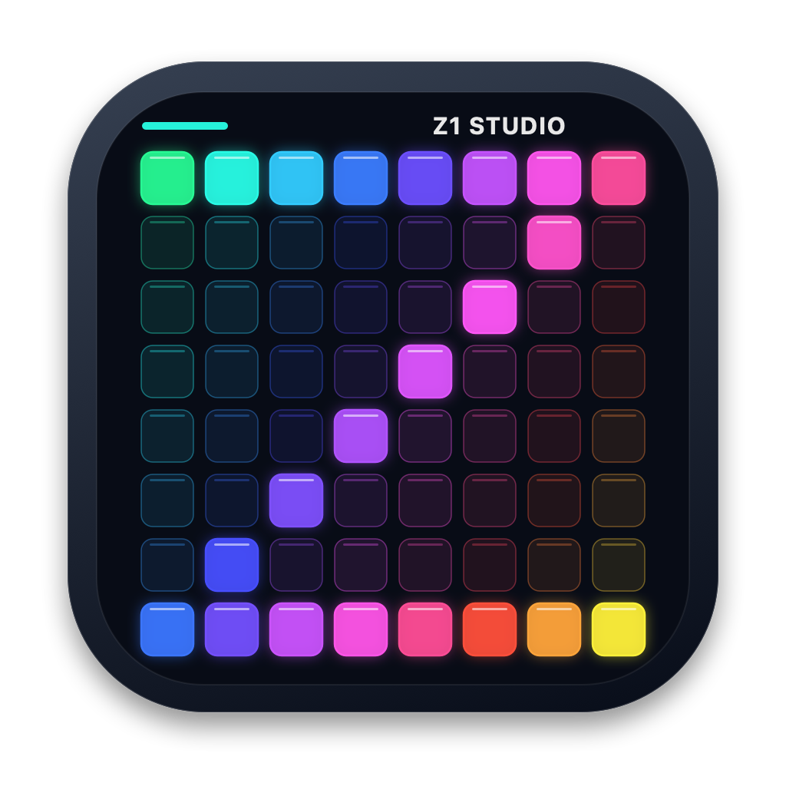
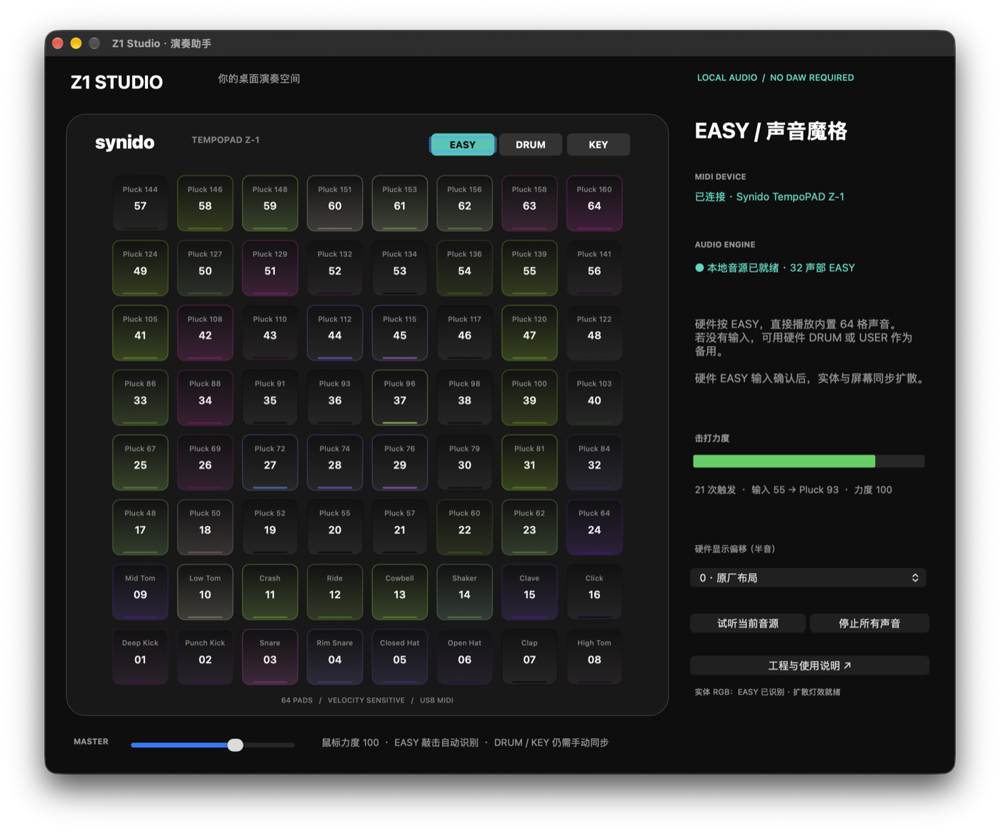
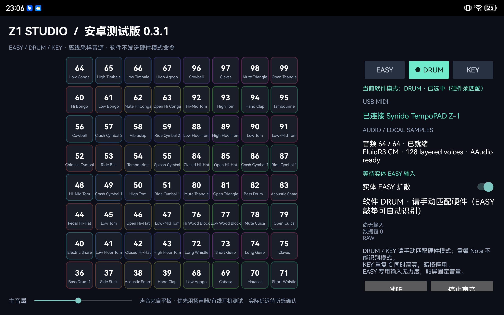

<p align="center">
  
</p>

<h1 align="center">Z1 Studio</h1>
<p align="center"><strong>Synido TempoPAD Z-1 演奏助手</strong><br>连接控制器，直接演奏鼓组、钢琴与 EASY 采样，不必启动官方软件或 DAW。</p>

<p align="center">macOS 13+ · Android arm64 · 本地离线演奏 · 非官方项目</p>



## 下载安装

**[打开 Releases 下载页](https://github.com/lonycn/synido-tempopad-z1-studio/releases/tag/v2.1-android-0.3.1)** · 当前为 **Pre-release 测试版**，两个平台版本独立。

| 平台 | 安装包 | 校验文件 |
|---|---|---|
| macOS 13+ / Apple Silicon | [macOS 2.1 ZIP · 约5MB](https://github.com/lonycn/synido-tempopad-z1-studio/releases/download/v2.1-android-0.3.1/Z1-Studio-2.1-macOS-arm64.zip) | [SHA-256](https://github.com/lonycn/synido-tempopad-z1-studio/releases/download/v2.1-android-0.3.1/Z1-Studio-2.1-macOS-arm64.zip.sha256) |
| Android arm64 | [Android 0.3.1 APK · 约148MiB](https://github.com/lonycn/synido-tempopad-z1-studio/releases/download/v2.1-android-0.3.1/Z1-Studio-Android-0.3.1-test.apk) | [SHA-256](https://github.com/lonycn/synido-tempopad-z1-studio/releases/download/v2.1-android-0.3.1/Z1-Studio-Android-0.3.1-test.apk.sha256) |

请下载对应 ZIP／APK，不是 GitHub 的 Source code 压缩包。Mac 构建未公证，Android 使用本地测试证书；兼容与原位更新限制见发布说明。私钥不会随安装包或源码发布。

## 能做什么

- **DRUM** — 64 个实体位置均有声音路由，保留 MIDI 真实力度；扩展音区复用部分 GM 鼓声，不是 64 种独立乐器。
- **KEY** — 采样钢琴、黑白键及停用位置，支持按住／松开与 CC64 延音；重复边界 C 同时高亮。
- **EASY** — 内置 64 段原创音频，支持重叠播放、屏幕动画及经过核查的实体 RGB 扩散。
- **看得明白** — 输入音符、声音映射、力度、连接与音源状态可见；Android 当前模式有青绿色 **● active** 高亮。
- **独立运行** — 构建和安装完成后，演奏不需要网络、Mac 伴随程序或官方控制面板。

## 平台与当前版本

| 平台 | 版本 | 音源与特点 | 验证范围 |
|---|---|---|---|
| macOS | **2.1 / Build 5** | 系统 GM 鼓／钢琴、原创 EASY 采样、RGB 扩散 | 本机 arm64；ad-hoc 签名，未公证 |
| Android | **0.3.1 / code 4** | FluidR3 GM 采样鼓／钢琴、AAudio、EASY 菱形扩散、模式高亮 | 华为 DBY-W09，HarmonyOS 4.2／Android 12 |



Android 声明最低 API 26，仅打包 `arm64-v8a`；这不代表所有兼容设备均已验收。iOS／iPadOS 暂无本项目的安装版本。

> **状态说明：** Android 的基础发声、位置及主观跟手性已有用户反馈；0.3.1 三模式高亮已在平板检查，用户确认调整 Octave 后 DRUM 对应恢复。全部音色、踏板、64 格、灯光收尾、长时间稳定性与声学延迟仍需分别实测。自动测试或音源“ready”不等于硬件验收。

## 连接与演奏

1. 用 Z-1 的 **USB-C 数据口**连接电脑，或通过数据线／OTG 连接支持 USB Host 的安卓平板。`DC-5V` 口只供电。
2. 打开助手，等待 MIDI 已连接、采样及音源已就绪。声音来自电脑／平板，Z-1 本身不是音箱。
3. **实体与软件都选择同一种模式。** 模式顺序为 `EASY → DRUM → KEY`。
4. 调整媒体音量与助手主音量；测试响应时优先使用扬声器／有线耳机，避免蓝牙延迟。

| 软件模式 | 实体模式 | 使用提示 |
|---|---|---|
| EASY | EASY | 首次真实敲垫可自动识别并触发声光；触屏试听不会授权实体灯光 |
| DRUM | DRUM | 轻重敲击使用收到的 Note 力度；松开不截断一次性鼓尾音 |
| KEY | KEY | 黑白键与停用格对应实体；重复 C 是同一 MIDI 音高，无法唯一定位来源 |

### 两个容易混淆的地方

**模式不是双向同步。** 软件不会发送未经核实的硬件模式命令。DRUM／KEY 的音符会重叠，不能按音高猜模式；屏幕 active 仅表示当前软件模式。

**EASY 没有实测力度。** 它的私有敲垫消息不含力度字段，因此显示“无力度数据／固定音量”；内部播放参数 100 不是 100% 或传感器读数。普通 MIDI Note 显示实际 `N/127`，触屏／试听也是固定触发值。

### 按键位置不对或右上角无声？

先检查实体 **Octave／Transpose**，不要立即重排映射。

默认 DRUM 四角为：**左上 64、右上 99、左下 36、右下 71**。本机曾因 Octave 升高两档，收到左上 88、左下 60、右下 95；用户降低两档后恢复。Android 当前布局接收 DRUM 36–99、KEY 36–84，超音区会提示实际输入和未演奏原因，不自动补偿八度。

macOS 可通过“硬件显示偏移”校准显示；Android 暂无同等偏移控件。只需调整当前八度，无需恢复出厂或写 USER 配置。

## 从源码构建

Git 源码历史**不提交预编译 App／APK、签名密钥或大音色库**。可安装文件通过上方 GitHub Releases 单独提供；如需自行构建，按以下步骤操作。

```bash
git clone https://github.com/lonycn/synido-tempopad-z1-studio.git
cd synido-tempopad-z1-studio
```

### macOS

准备 macOS 13+、Xcode Command Line Tools、Python 3；普通构建不需要 NumPy。

```bash
# 先正常退出正在运行的助手
./scripts/build.sh
python3 scripts/validate.py
"dist/Z1 演奏助手.app/Contents/MacOS/Z1Player" --model-test
"dist/Z1 演奏助手.app/Contents/MacOS/Z1Player" --self-test
open "dist/Z1 演奏助手.app"
```

生成 ZIP：`./scripts/package.sh`。本机构建使用 ad-hoc 签名，未做开发者公证；不要假定可在其他 Mac 直接打开，也不建议关闭系统安全功能。当前主要验证 arm64。

`validate.py` 会检查构建资源；若维护工作区中存在本地 EASY／GarageBand 历史工程，还会检查它们。公开源码未包含这些工程，可用 `--require-local-archives` 在维护环境要求其完整存在。

### Android

当前构建脚本以 **macOS 主机**为目标，需要预先安装：

- JDK 17；Android SDK Platform 35、Build Tools 35.0.0。
- Android NDK **23.1.7779620**，以及宿主 `clang++`。
- Python 3。不依赖 Gradle／Maven 下载。

```bash
# 首次准备：联网下载固定版本的 FluidR3 字体，验证摘要后仅提取数据
python3 android/fetch_soundfont.py

# 此后离线构建；包含 Java、控制器替身、菱形与真实音色 host 测试
./android/build.sh
```

输出：`dist/android/Z1-Studio-Android-0.3.1-test.apk` 及 `.sha256`。构建不会连接 ADB 或向真实设备发送 MIDI。

首次构建会生成自己的本地测试签名密钥 `android/local/test.keystore`。**它不能覆盖由另一把密钥签名的已装版本。** 原位更新须保留原密钥、核对实际旧包证书；不以卸载绕过签名不匹配。密钥不应提交到 Git。

更多行为与限制见 [Android 使用说明](android/README.md)。

## 灯光与设备安全

实体 RGB 测试会改变当前灯光。输出只允许已核实的 EASY 259 字节 RGB 全帧，且仅在**唯一、同一物理 USB Z-1、真实 EASY 输入授权**后发送。

- 严格限制发送尝试频率，保留尾黑帧、失败上限与异步连接清理。
- 普通 Note 撤销灯光授权；DRUM／KEY 力度不能授权 EASY 灯效。
- 不升级固件、不恢复出厂、不写 USER 配置、不发送猜测的 SysEx、不读取／破解加密 EAS。
- 物理拔线后无法保证熄灯；只按模式键而未敲新垫时，也不能立即知道硬件已切换。

协议边界见 [RGB 与模式核查](references/PROTOCOL_V21.md)。

## 已知限制

- Android 完整音色库使 APK 约 **148 MiB**，首次运行另需约 148 MB 私有缓存；目标平板一次 PSS 快照约 387 MiB，不是峰值上限。
- AAudio 输出路由错误会安全静音并提示重开 App，暂不自动热恢复；EASY 播放仍独立可用。
- TinySoundFont 不支持全部 SF2 调制、混响和合唱；128 分层声部不等于 128 个用户音符。
- Android 无网络、录音、麦克风或存储权限。开发期 ADB 与 UI 诊断不属于正常演奏所需权限。
- macOS 启动时会请求正常退出官方软件／GarageBand，避免重复发声；遇未保存工程不强杀。

## 项目结构

```text
src/                 macOS AppKit / CoreMIDI / 音频与灯光
android/src/         Android 界面、布局、owner、MIDI 与生命周期
android/native/      TinySoundFont 合成封装、JNI / AAudio、host 测试
android/vendor/      固定版本 TinySoundFont 及许可证
android/assets/      离线许可；FluidR3 字体在本机准备，不入 Git
assets/              原创 EASY 音频与品牌图标
app/                 macOS 元数据与图标
scripts/             macOS 构建、打包、校验及素材生成
docs/                架构、使用、测试与历史审查说明
references/          自写协议研究及第三方来源说明
```

`dist/`、`generated/`、`backups/`、`tests/reports/`、设备日志与签名目录仅在维护工作区生成／保留，不随源码发布。历史文档可能引用这些本地证据或未随仓库分发的工程。

## 许可与第三方内容

本项目不是 Synido 官方产品，也未声明获得厂商背书。**原创代码暂未指定统一开源许可证**，公开仓库不代表第三方内容可任意再分发。

- TinySoundFont：MIT，保留完整版权／许可；版本固定。
- FluidR3 GM 字体数据：MIT，下载及提取前校验固定摘要；不向 Git 历史提交原始字体。发布的 Android APK 包含字体及完整版权／许可，不执行 Debian 安装包或分发其维护脚本。
- macOS Apple DLS／GarageBand 音色、厂商 PDF／官方工程均不随本仓库分发。
- 原创 EASY 音频与 Z1 Studio 图标在仓库中；第三方 notice 及来源摘要见 [来源说明](references/SOURCES.md) 和 `android/assets/licenses/`。

---

[Android 指南](android/README.md) · [架构](docs/ARCHITECTURE.md) · [测试](docs/TESTING.md) · [维护](docs/MAINTENANCE.md) · [更新记录](CHANGELOG.md)
